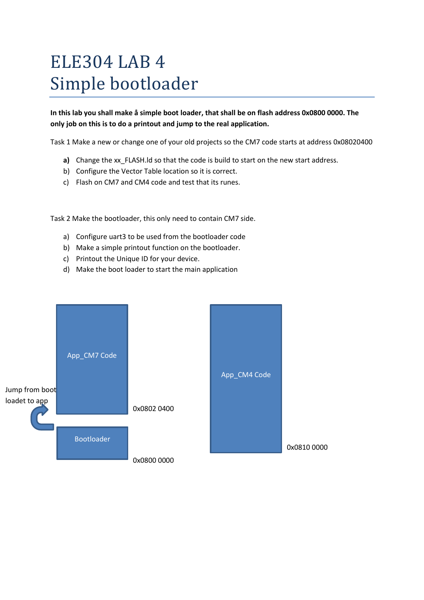
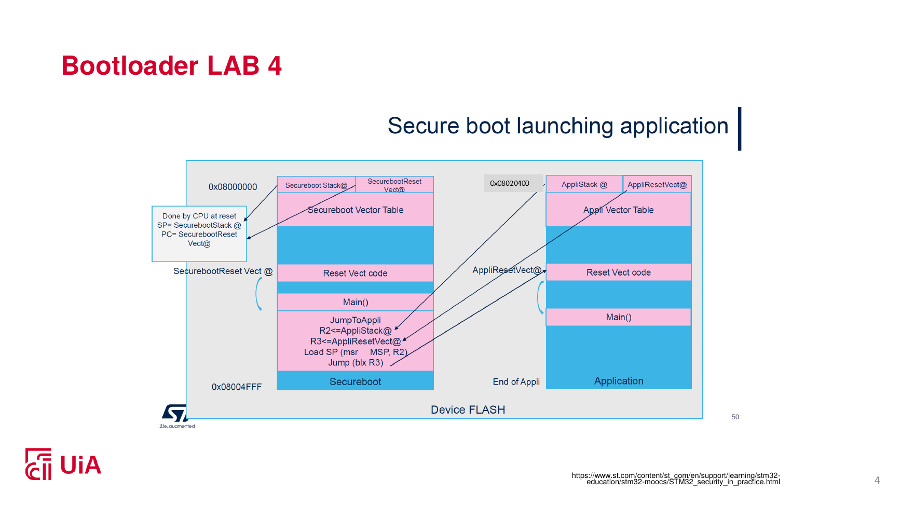
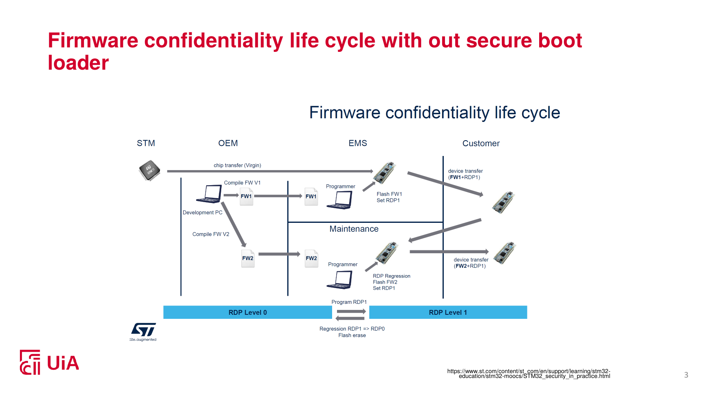
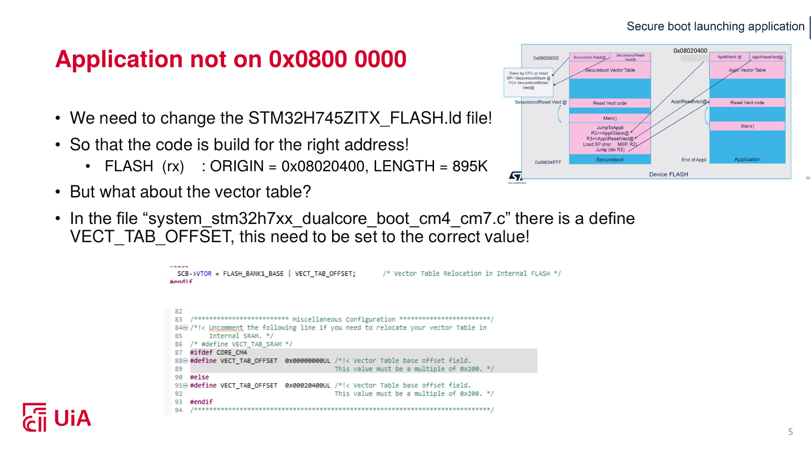
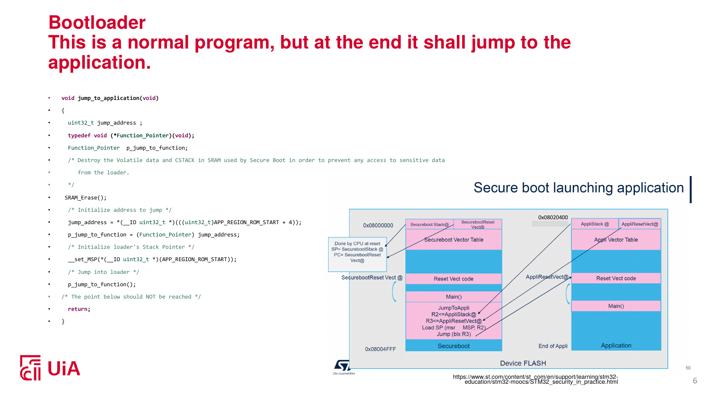
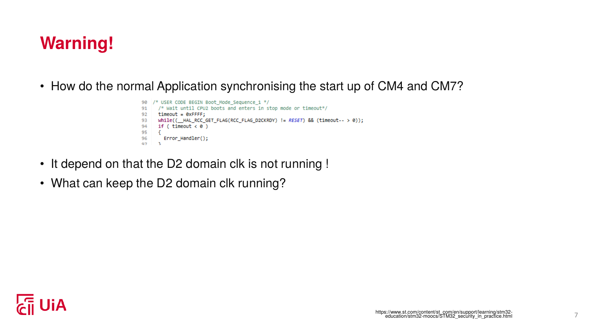

# ELE304 Lab 4: Simple Bootloader (STM32H745/H755, Cortex-M7 + M4)

## Overview

This lab builds a two-part firmware system on the NUCLEO-H755ZI-Q dual-core board.

1. A small **bootloader** sits at the start of flash (`0x0800 0000`). It starts first, prints the chip's **Unique ID** over UART3, checks the application, and then **jumps** to it.
2. The **application** (my earlier Lab 1 project) was **relocated** in flash to `0x0802 0400`, so that it no longer overlaps the bootloader.

<p align="center">
  
  <br><sub>Lab 4 task sheet (ELE304, UiA): bootloader at 0x0800 0000, CM7 app at 0x0802 0400, CM4 app at 0x0810 0000.</sub>
</p>

## Flash memory map

| Region | Start address | Content |
|---|---|---|
| Bootloader (CM7 only) | `0x0800 0000` | New project, 128 KB region |
| Application CM7 | `0x0802 0400` | Lab 1 project, moved |
| Application CM4 | `0x0810 0000` | Unchanged (flash bank 2) |

<p align="center">
  
  <br><sub>Bootloader and application in flash: the reset code runs first, then jumps to the application's reset handler. Source: ELE304 lecture slides (UiA), adapted from the ST STM32 security MOOC.</sub>
</p>

## Background: topics in this lab

**Bootloader.** A small program that runs right after reset, before the main application. It prepares the system and then hands control to the application. Here it is user code in flash, not ST's built-in ROM bootloader.

**Linker script.** It tells the linker where in memory each section (`.isr_vector`, `.text`, `.data`, `.bss`) goes. Moving the application means changing the `FLASH` origin and length.

**Vector table and `VTOR`.** The vector table holds the initial stack pointer (word 0) and the address of the reset handler (word 1), then the interrupt handlers. The register `SCB->VTOR` says where the core looks for this table. If the app is moved but `VTOR` is not updated, interrupts (SysTick, UART) jump to the wrong table and the app hard-faults.

<p align="center">
  
  <br><sub>Context: firmware life cycle without a secure boot loader. Source: ELE304 lecture slides (UiA), ST STM32 security MOOC. This lab covers only the simple jump, not secure boot.</sub>
</p>

**Unique ID (UID).** Every STM32 chip has a factory-programmed 96-bit ID, read from three 32-bit words at `0x1FF1E800`, `+0x04` and `+0x08` on the H7.

**UART3.** USART3 on PD8/PD9, 115200 8N1, goes through the ST-LINK virtual COM port, so the bootloader can print to a PC terminal.

**Jumping to an application.** Load the stack pointer from the app's first word, then branch to the reset handler in its second word. Before jumping, the bootloader must undo what it set up (cleanup), because the app assumes a clean, just-reset system.

**Dual-core handling.** On the H745/H755 the CM7 and CM4 each have their own start-up and synchronisation code. The bootloader runs on the CM7 only, and the CM4 stays asleep until the app's own start-up code wakes it.

## What I did

### Task 1: Move the CM7 application to `0x08020400`

<p align="center">
  
  <br><sub>The two changes that must match: the linker <code>FLASH</code> origin and <code>VECT_TAB_OFFSET</code>. Source: ELE304 lecture slides (UiA).</sub>
</p>

1. In the CM7 linker script (`STM32H745ZITX_FLASH.ld`), changed the flash region to `ORIGIN = 0x08020400, LENGTH = 895K` (1024K minus the 129K skipped, so the app cannot reach bank 2).
2. In `system_stm32h7xx_dualcore_boot_cm4_cm7.c`, set `VECT_TAB_OFFSET` to `0x00020400`.
3. Rebuilt and flashed. Checked the `.map` file and the memory at `0x08020400`: stack pointer `0x24080000`, reset handler `0x08021481`. The CM4 map still had `.isr_vector` at `0x08100000`. Both cores ran and both LEDs toggled.

### Task 2: The bootloader

**a) UART3 setup.** Created a new project for the NUCLEO-H755ZI-Q. USART3 is asynchronous, 115200 8N1, on the CM7, no interrupt and no DMA. Linker script: `FLASH ORIGIN = 0x08000000, LENGTH = 128K`. The `.map` shows `.isr_vector` at `0x08000000` and the image is about 21 KB.

**b) Print function.** `print()` wraps `HAL_UART_Transmit(&huart3, ..., strlen(s), 100)`. Tested with Tera Term (COM5, 115200 8N1).

**c) Print the Unique ID.** Read the three words at `0x1FF1E800` with `volatile` pointers and printed them in hex.

**d) Start the application.**

<p align="center">
  
  <br><sub>Reference outline from the lecture (set the main stack pointer, branch to the reset handler). My own version also validates the app and cleans up before the jump, see below. Source: ELE304 lecture slides (UiA).</sub>
</p>

1. **Validate** the first two words of the app: stack pointer inside AXI SRAM, reset handler inside `0x08020400` to `0x08100000`, Thumb bit set.
2. **Clean up:** disable interrupts, `HAL_UART_DeInit` (also switches off the USART3 clock), stop SysTick, clear NVIC enable and pending bits, set `VTOR`, re-enable interrupts.
3. **Jump:** set the main stack pointer from the app's first word and branch to its reset handler.
4. **CM4:** the bootloader's own CM4 wake-up code is disabled (`#if 0`), so the app's start-up sync wakes the CM4.

## Boot sequence

```mermaid
flowchart LR
  A[Reset] --> B[CM7 starts at 0x08000000<br/>CM4 waits in STOP]
  B --> C[Bootloader prints banner and UID]
  C --> D{App valid?}
  D -- yes --> E[Cleanup, set VTOR, jump]
  E --> F[App SystemInit sets VTOR = 0x08020400]
  F --> G[App wakes CM4, LEDs toggle]
  D -- no --> H[Print "No valid application", loop in bootloader]
```

1. Reset: the CM7 starts at `0x08000000` with the bootloader vector table, and the CM4 waits in STOP.
2. The bootloader prints the banner and the UID, validates the app, and prints "Jumping to application".
3. The app's reset handler runs and its `SystemInit` sets `VTOR = 0x08020400`.
4. The app wakes the CM4, and the LEDs toggle.

## Results

Terminal output after reset:

```
(banner)
UID: <3 x 32-bit words, hex>
APP SP=24080000 RESET=08021481 valid
Jumping to application
```

- My board's UID printed as `0051002C-32335104-32383537`.
- The application ran after the jump and the LED toggled.
- `.isr_vector` is at `0x08000000` in the bootloader map and at `0x08020400` in the app map.

## Repository contents

- `bootloader_lab4/`: bootloader project (CubeIDE/CubeMX; CM7 is the bootloader, CM4 is CubeMX's empty stub)
- `docs/bootloader_CM7.map`: linker map of the bootloader (`.isr_vector` at `0x08000000`)

Not included here: the relocated Lab 1 application (CM7 + CM4), the terminal screenshot and the demo video.

## Issues faced and how I solved them

### 1. Setting up the lab 4 project
- **Problem:** I copied my Lab 1 project to make the Lab 4 app, and could not find the `.ioc` file to rename.
- **Cause:** Windows was hiding file extensions, so it showed as `ele_304_lab1` with only the CubeMX icon.
- **Fix:** Turned on *View > Show > File name extensions*, renamed it to `ele_304_lab4.ioc`, and replaced the old name inside `.project`, `.cproject` and the `.launch` files.
- **Learned:** If a rename misses one config file, the new project can silently point at the old one. Keep the original project untouched as a backup.

### 2. CubeIDE 2.x has no built-in CubeMX
- **Problem:** I could not create the bootloader project with the integrated pin and clock configuration.
- **Fix:** Created the project in standalone CubeMX for the NUCLEO-H755ZI-Q and imported it into CubeIDE.

### 3. `Error_Handler()` hit at `main.c:188`, before the jump (the "FastTake" problem)
- **Symptom:** After I commented out `HAL_HSEM_FastTake`, the program stopped in `Error_Handler()` and nothing printed.
- **How I found it:** The call stack showed `main()` at line 188 calling `Error_Handler()`, in the bootloader's own address range (`0x0800xxxx`), so the failure was in the generated start-up code, not in my application.
- **Cause:** The generated CM7 `main()` has a dual-core boot-sync block: *take semaphore, release it (which wakes the CM4), wait for the CM4 to wake, time out into `Error_Handler()`*. I had commented out only the `FastTake` line. The `Release` and the wait loop stayed, so the CM7 waited for a CM4 that was never woken and timed out.
- **Fix:** Disable the whole wake-up block together (from `__HAL_RCC_HSEM_CLK_ENABLE` to its closing `#endif`), not one line of it. The application's own start-up code then wakes the CM4.
- **Also noticed:** A CM4 debug session halted at `main()` never enters STOP mode, so the first sync wait can time out too. Resume the CM4 first so it reaches STOP.
- **Learned:** In a take/release/wait handshake the lines go together. Disable all of them or none.

### 3b. Where the CM4/CM7 sync comes from

<p align="center">
  
  <br><sub>The lecture's warning: the boot sync depends on the D2 domain clock not running. Source: ELE304 lecture slides (UiA).</sub>
</p>

### 4. HardFault inside `SCB_DisableDCache()` during cleanup
- **Symptom:** The terminal stopped after "Jumping to application".
- **How I found it:** The call stack read from the bottom up: `main()` called `jump_to_application()`, which called `SCB_DisableDCache()`, and the fault happened there. So the app was never started and the problem was not `VTOR` or the app.
- **Likely causes:** `SCB_DisableDCache()` can misbehave in unoptimised (`-O0`) builds; the MPU was disabled one line earlier; the bootloader may never have enabled the caches.
- **Fix attempted:** Commented out `SCB_DisableICache()` and `SCB_DisableDCache()` (safe here, because the app sets up its own caches).
- **Learned:** Read the call stack first for *where* the fault is. The fault registers (`CFSR` at `0xE000ED28`, `HFSR` at `0xE000ED2C`) tell *why*.

### 5. "Nothing prints after the jump"
- **My question:** Should I write code to do something after jumping?
- **Answer:** No. After the jump the CPU belongs to the application, and the bootloader never gets control back unless there is a reset. Silence can mean the app is running fine but does not print, the app prints differently (UART was de-initialised and must be re-initialised by the app), or the app crashed.
- **How to tell:** Suspend the debugger and read the **PC**. In `0x0802xxxx` to below `0x08100000` the app is running. In `0x0800xxxx` it is still in the bootloader, in an error or fault handler.
- **Learned:** "Nothing printed" is not a result. Check the CPU state, and know what the app is supposed to do.

### 6. Overwritten CM4 application
- **Problem:** Debugging the bootloader flashed CubeMX's empty CM4 stub (`bootloader_lab4_CM4`) into bank 2 at `0x08100000`, replacing my Lab 4 CM4 app.
- **Fix:** Create the bootloader's debug configuration for the CM7 only, and re-flash the Lab 4 CM4 app afterwards.

### 7. Moving the app: the vector table
- **Problem:** Relocating the linker address alone is not enough.
- **Fix:** Also set `VECT_TAB_OFFSET = 0x00020400`, otherwise `SystemInit` writes the old `VTOR` and the app hard-faults at its first interrupt (SysTick or UART).

## Questions I asked and what I learned

| My question | What I learned |
|---|---|
| What is asked in Lab 4 and what should I do? | Two parts: relocate the app, and write a bootloader that prints the UID and jumps. |
| Is a bootloader the same code as a normal program? What is the memory map of an STM32H7? | Yes, it is ordinary code placed at a fixed address. The 32-bit address space is split into flash, SRAM, peripherals and the core's own registers, and the linker script decides where each program section goes. |
| Should I copy the old project or make a new one? | Copy Lab 1 for the app (Method A). Create a fresh project for the bootloader (Method B). |
| Why is it not working after I commented out `FastTake`? | The boot-sync handshake has several parts that must be changed together (see issue 3). |
| Should I write code to run after the jump? | No, see issue 5. |
| The LED is toggling after "Jumping to application". Is that it? | It proves the stack pointer, reset handler and jump work. It only proves interrupts work if the blink uses `HAL_Delay`, which needs SysTick. The real test is a cold reset with no debugger attached. |

**Where I got stuck most:** reading the debugger. I looked at the terminal text and guessed, when the call stack and the PC would have told me where the failure was.

## Key takeaways

- Moving an application needs two changes that must match: the **linker address** and the **`VTOR` value**.
- A bootloader must **clean up** (interrupts, SysTick, NVIC, peripherals) before the jump.
- On a dual-core chip, decide which core's start-up code does the wake-up. Doing it in both places breaks the sync.
- When something fails, read the **call stack and PC first** to find where, then the fault registers to find why. Do not guess from silence.

## Build and run

1. Build `app/CM7` and `app/CM4`, and build `bootloader/CM7`.
2. Flash the bootloader at `0x08000000`, the CM7 app at `0x08020400`, and the CM4 app at `0x08100000`.
3. Open a terminal (115200 8N1) on the ST-LINK COM port and press reset.

## Credits and third-party material
- The figures in `docs/images/` (slides 3-7 and the Lab 4 task sheet) are from the ELE304 course material of the University of Agder (UiA), which in turn uses slides from ST's STM32 security MOOC. They are **not my work**; they are included only as educational reference, with the source logos left visible. If the rights holders object, I will remove them.
- `bootloader_lab4/Drivers/` and the generated start-up and system files are from STMicroelectronics (STM32CubeH7 HAL, CMSIS) under their original licences, which are kept in the files.
- The bootloader code, the linker-script change, the cleanup sequence and the debugging notes in this README are mine.
